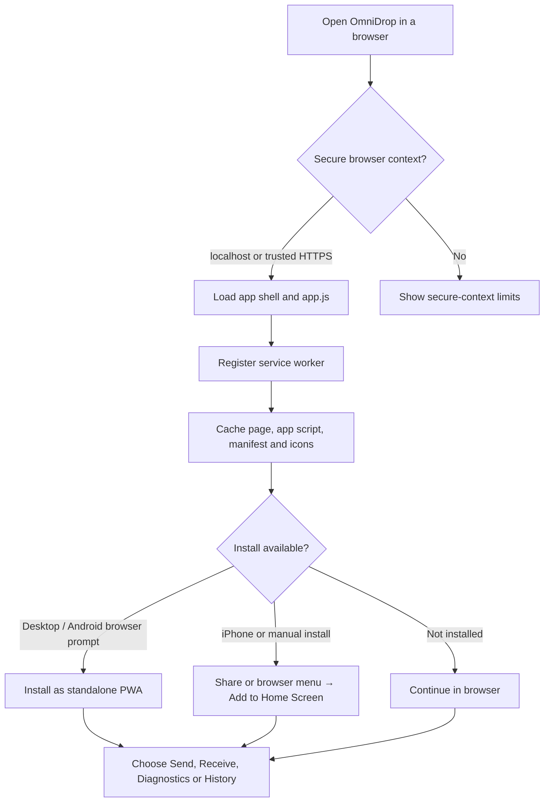
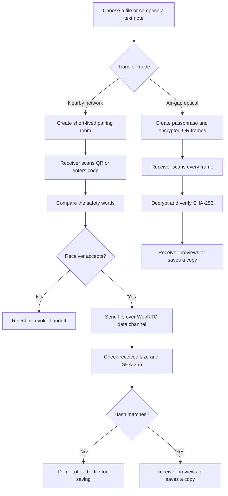
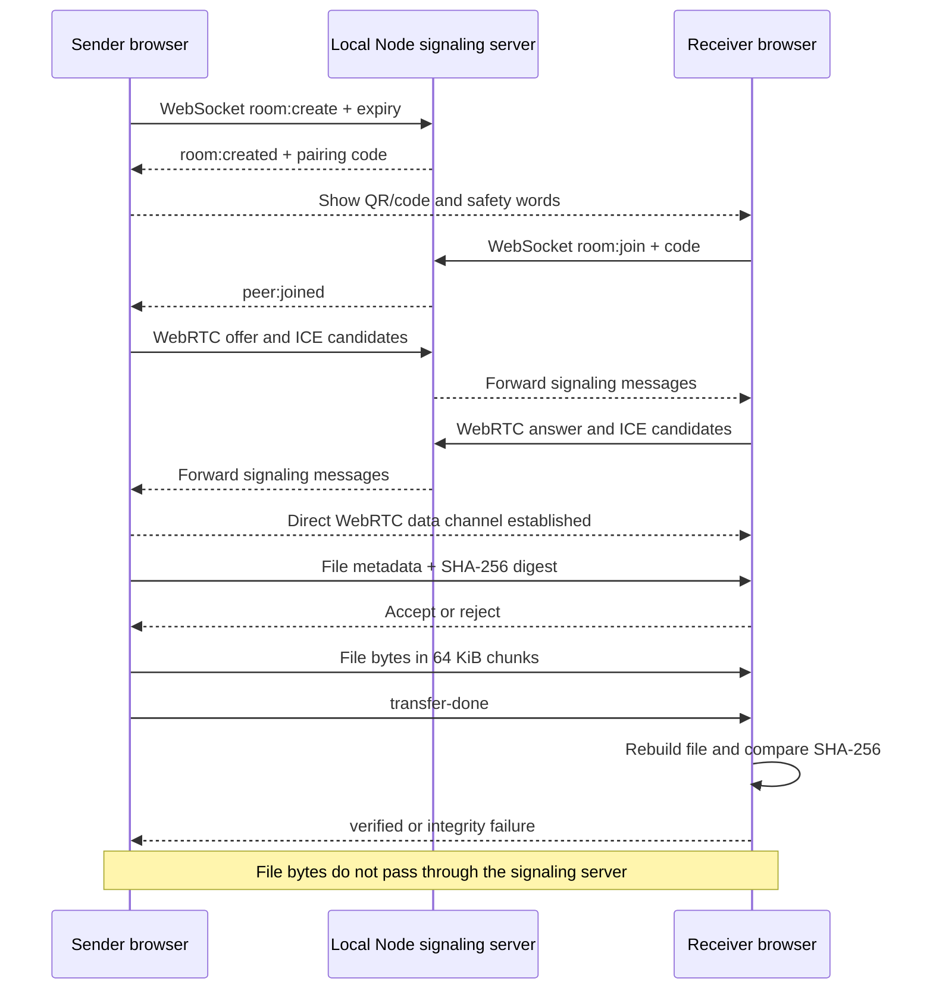
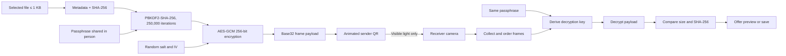

# OmniDrop project workflow and data flow

OmniDrop is a browser-based, installable file-sharing app. It has two transfer routes: nearby-network transfer over WebRTC, and a small-file optical route that transfers encrypted QR frames without a network. The Node.js server serves the app and coordinates pairing; it does not relay file contents.

## 1. App startup and install



The service worker caches the app shell after a successful load so the interface can reopen offline. Offline shell availability does not mean the signaling server is available: nearby WebRTC transfers still need the server and a shared local network. Camera and Web Crypto features need localhost or a trusted HTTPS origin.

## 2. Choose a transfer route



## 3. Nearby-network transfer: message and file flow

The sender creates a room through the local signaling server. The receiver joins with the 10-character code. The server forwards WebRTC offer, answer and ICE candidate signaling data so the browsers can establish a direct connection. After connection, the file bytes travel directly between browsers in a DTLS-encrypted WebRTC data channel.



The server holds each active room in memory, allows one receiver, expires rooms after the selected lifetime, and closes both peers on expiry or revoke. Its signaling rate limit is 30 actions per IP per minute. The server sees pairing codes, signaling metadata, and peer network metadata; it does not receive the file chunks. No account or cloud file store is used.

The backend caps the process at 1,000 active rooms and 2,000 WebSocket connections. It sends WebSocket pings every 25 seconds and releases clients that do not answer, so dead mobile connections do not keep rooms around until their full expiry. The `/health` endpoint reports service status, active-room count and uptime; it never reports file data.

## 4. Offline optical transfer: frame and data flow

Both devices must first open the app over trusted HTTPS and keep the pages loaded. The sender selects a file up to 1 KB and creates a passphrase of at least eight characters. The passphrase must be shared separately; it is never embedded in the QR frames. The sender encrypts the file and metadata, then displays changing QR frames. The receiver scans the frames, reassembles the payload, decrypts it, and verifies the SHA-256 digest.



The scanner uses the browser's `BarcodeDetector` QR support. Frames repeat to help recover missed scans. No network is needed after both pages are already loaded. Anyone who can see or record the sender's screen can capture the encrypted frames, so the passphrase should be shared out of band.

## 5. Data handled by the app

| Data | Where it is handled | Lifetime / purpose |
| --- | --- | --- |
| Selected file bytes | Sender browser memory | Until the session is cleared or page closes; sent peer-to-peer for nearby mode |
| Pairing code and SDP/ICE | Sender, receiver, signaling server | In-memory room coordination; removed on expiry, revoke, or disconnect |
| File name, MIME type, size, SHA-256 | Sent over the WebRTC data channel; also encrypted into optical payload metadata | Receiver uses it to validate and reconstruct the offered file |
| Received file bytes | Receiver browser memory | Held until saved, cleared, or page closes; the app does not persist file contents |
| Recent transfer entry | Browser `localStorage` on that device | Up to 50 entries; name, size, direction, route and timestamp only |
| PWA shell files | Browser Cache Storage | Allows the interface to reopen offline after the first successful load |
| Passphrase | User memory / out-of-band exchange | Used to derive the optical encryption key; not sent in QR frames |

## 6. Current implementation limits

- Nearby-network file size: up to 50 MB. Transfer uses 64 KiB chunks and checks SHA-256 before offering Save.
- Nearby networking expects both devices on the same LAN. There is no STUN/TURN relay or internet fallback; Wi-Fi client isolation can prevent a direct connection.
- One receiver can join each room. Rooms support the UI's 10-minute, 1-hour, or 24-hour choices and are held in server memory.
- Offline optical file size: up to 1 KB. Camera QR support varies by browser; test the target phone and browser before relying on an air-gap transfer.
- There is no native Wi-Fi Direct, multi-file transfer, transfer resume, account, or cloud storage.
- Rooms, rate-limit counters, and live sockets exist in one Node process. Restarting it closes transfers; multiple server replicas will not share a room. A shared signaling broker is needed before horizontal scaling.
- Behind a reverse proxy, enable `TRUST_PROXY=true` only when the trusted proxy overwrites `X-Forwarded-For`; otherwise the rate limiter uses the direct socket address.
- Revoke and expiry close the live handoff but cannot remove a copy already saved by the receiver.
- This is a prototype and has not had a production security review.

## 7. Main project files

| File | Responsibility |
| --- | --- |
| `index.html` | User interface, WebRTC pairing and transfer, QR encoding/decoding, encryption and integrity checks |
| `server.mjs` | Static app server, health endpoint, WebSocket signaling rooms and room expiry |
| `Dockerfile` | Small Node container image and `/health` container health check |
| `app.js` | Install prompt, service-worker registration, local transfer history and diagnostics |
| `sw.js` | Offline app-shell cache |
| `manifest.webmanifest` | Install name, display mode, colors and app icons |
| `icon.svg`, `icon-192.png`, `icon-512.png` | Browser and installed-app icons |

## 8. Run locally

```sh
npm start
```

Open `http://localhost:4173` in two tabs on one computer for a same-device demo. To use a phone, serve the app from a LAN host that the phone can reach over trusted HTTPS; set `OMNIDROP_TLS_CERT` and `OMNIDROP_TLS_KEY` to the certificate and key paths before starting the server. Do not bypass browser certificate warnings.

For container deployment, run `docker build -t omnidrop .` and `docker run --rm -p 4173:4173 omnidrop`. A public reverse proxy must support WebSocket upgrades at `/signal`. Keep one backend instance while sessions are in-memory.

Vercel is configured to build the root `Dockerfile` with its Container runtime. Pairing state is currently process-local. Before scaling Vercel to multiple server instances, move room creation, lookup, and signaling relay to a shared Redis-backed broker so the sender and receiver can connect through different instances.
